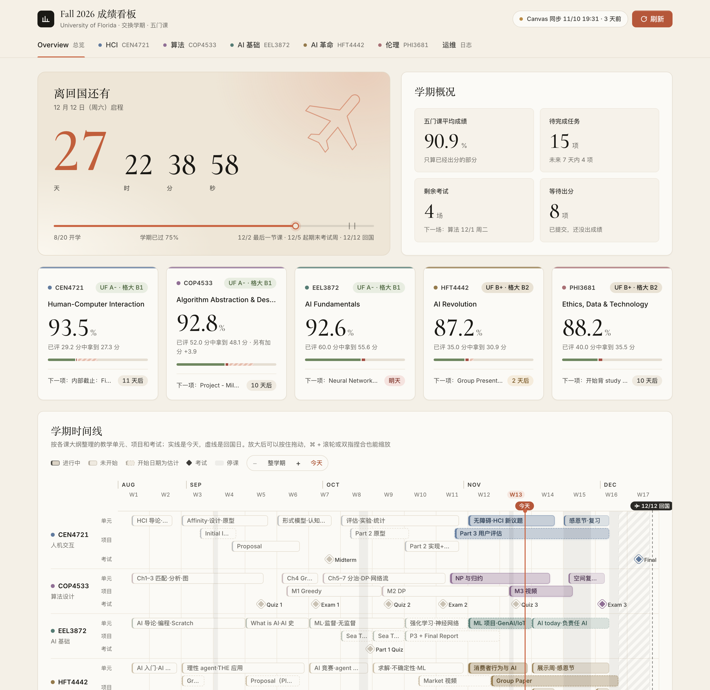
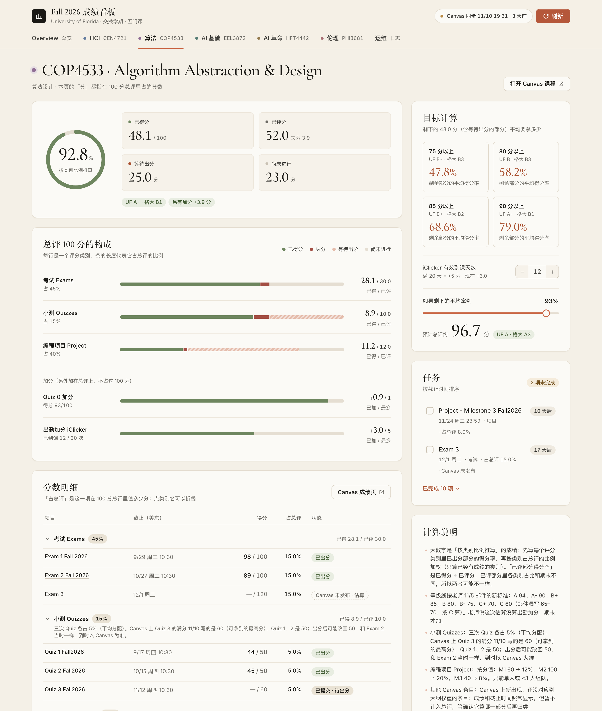

# Canvas 成绩看板 · Canvas Grade Dashboard

每天定时从 Canvas 读取五门课的作业、截止时间和成绩，用甘特图和待办清单管理一个学期的进度，并按大纲权重算出每门课现在的成绩、离目标还差多少。

A personal dashboard that pulls assignments, deadlines and grades for five courses from Canvas on a schedule, tracks the semester with a Gantt chart and a to-do list, and recomputes each course grade from the syllabus weights.

> **仓库里的分数是示例数据。** 课程结构、权重和日期来自我在佛罗里达大学交换的 2026 秋季学期，每项作业的得分是编造的，个人备注已删除。
> **The scores in this repository are sample data.** Course structure, weights and dates are real; every score is made up.



## 为什么做

- Canvas 按课程分开显示。五门课的截止时间和成绩要点进五个页面才能看全，哪一周最紧、哪门课最危险，没有一个地方能一眼看出来。
- Canvas 算出的总评经常和大纲对不上：有的课不加权，有的课把考试放在 0% 的组里，有的按满分值拆权重而大纲写的是「三次考试各 15%」。
- 思路和我实习时做的监控看板一样：**定时取数 → 按确定的规则计算 → 页面展示 → 有变化时通知**。

## 功能

| 页面 | 内容 |
|---|---|
| 总览 | 学期概况、五门课的当前成绩卡片、按大纲整理的学期甘特图（教学单元、项目阶段、考试）、全部待办 |
| 每门课 | 当前成绩、总评 100 分的构成、目标计算（到各档目标线，剩下的部分平均要拿多少）、分数明细、这门课的待办 |
| 运维 | 每次定时运行的日志（成功、登录过期、校验失败）、系统怎么运作、更新日志 |



其他细节：

- 待办清单里，在 Canvas 上提交过的会自动勾掉；Canvas 上没有的事（课上展示、自己定的提前完成日）可以手动加。
- 甘特图可以缩放和拖动，按校历标出停课日。
- 对不上大纲的 Canvas 新条目不会被悄悄丢掉，会放进「其他 Canvas 条目」，标「未计入总评」。
- 深色模式和手机布局。

## 怎么工作

```
浏览器里已登录的 Canvas（只读 GET 接口）
        │  canvas_fetch.js：一次读出五门课的作业组、分值、截止时间、本人提交和成绩
        ▼
snapshot.js（本地）+ 云端数据库里的最新快照        ← 每天 7:30 / 19:30 的定时任务覆盖
        │
        ▼
index.html  ←  config.js（权重、计分口径、Canvas 上没有的待办、甘特图，手动维护）
        │
        ├─ 页面：总览 / 每门课 / 运维
        └─ export_timeline.mjs → timeline.json（给编辑器里的截止倒计时用）
```

| 文件 | 作用 |
|---|---|
| `index.html` | 整个看板：单文件，没有构建步骤，没有第三方依赖 |
| `config.js` | 课程模型：权重、计分口径、手动加的待办、甘特图 |
| `snapshot.js` | Canvas 快照。这里是示例数据；真实使用时每天被覆盖 |
| `canvas_fetch.js` | 在已登录 Canvas 的标签页里运行的抓取脚本，只调用 GET 接口 |
| `export_timeline.mjs` | 复用看板的计算代码，把每项任务的截止时间和状态导出成 `timeline.json` |
| `changelog.js` | 更新日志，「运维」页会显示 |
| `docs/refresh-runbook.md` | 定时任务每次运行照着做的步骤 |

## 几个设计决定

- **只读，不碰密码。** 抓取只用 GET 接口。定时任务一遇到学校登录页就停下，绝不输入账号密码。代价是登录过期时会跳过刷新，所以后来加了运维页，让失败原因能一眼看到。
- **数据和口径分开。** `snapshot.js` 是机器每天覆盖的原始数据，`config.js` 是人维护的规则。刷新永远不改规则。
- **计算用确定的代码。** 成绩怎么算全部写在页面的脚本里，每个数字旁边都能看到它是怎么来的（「计算说明」）。
- **Canvas 和大纲不一致时，按大纲重算并写明。**
- **每次运行都留日志。** 不管成功还是失败，都记下做了什么、有哪些变化。

## 本地运行

没有依赖。下载后双击 `index.html` 即可，看到的是示例数据。

换成自己的课程需要改三处：`canvas_fetch.js` 里的学校域名和课程 ID，`config.js` 里的课程模型，然后在已登录 Canvas 的标签页里运行 `canvas_fetch.js`，把输出存成 `snapshot.js`。

## 说明

- 这个项目是用 Claude Code 做的：需求、计分口径、每一版要改什么和验收由我负责，代码由 AI 写。从首版到 v3.10，`changelog.js` 里记了 12 次改版和 2 次事故。
- 定时刷新靠 Claude 桌面应用的定时任务，加上浏览器扩展去读已登录的 Canvas；线上版本是一个带云端数据库的 Claude Artifact。这两部分依赖我自己的账号，仓库里没有。本地打开时，「运维」页的运行日志是空的，「刷新」按钮只会重新读取 `snapshot.js`。

## License

MIT
